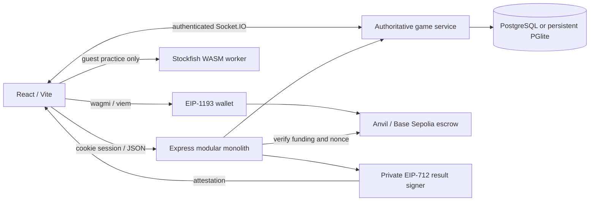

# Architecture

`apps/web`: lazy routes, design tokens, handcrafted homepage artwork, board interactions, UCI worker, account and Arena interfaces. `apps/api`: sessions, input validation, database access, serialized game mutation and wallet verification. `packages/game-core`: legal moves, clocks, outcomes and Elo. `packages/shared`: game types, bot settings and contract ABIs. `packages/contracts`: demo ERC20 and escrow, with Foundry tests.

The API runs as one persistent Node process. It serializes game mutations before PostgreSQL transactions, validates every move and participant, and increments the game revision. Retries carrying an old revision are rejected; reconnect fetches the latest persisted PGN. Clocks use elapsed wall time and continue during disconnection and process downtime. Rated results update both players in the same transaction as the final record, guarded by a one-time `rated_applied` transition.

PGlite embeds PostgreSQL in the API and persists under `.data/postgres`. This makes the Windows checkout runnable without Docker. `DATABASE_URL` swaps to a PostgreSQL pool using identical SQL. Startup applies idempotent initial schema statements. Future migrations need explicit versioned migrations; destructive schema changes must never be added to the startup script. Prisma is intentionally not introduced alongside this small SQL access layer, avoiding two schema definitions.

The matchmaking queue is ephemeral and single-process. Restart loses queue entries, but not games/accounts. Disconnect removes queue entries. Multiple API instances require a distributed game owner and queue (e.g. Redis), distributed rate limits and concurrency redesign; simply adding a load balancer is unsupported.

Wallet connection and authentication are separate. EIP-4361 signatures bind domain, URI, chain, nonce and expiry. Nonces are consumed atomically. A wallet links to at most one user through a unique constraint. Public profile queries omit wallet and email. Arena game creation reads the contract, requires both deposits, resolves both verified wallets to user IDs and stores the on-chain match ID. Only completed server-owned games can receive result signatures.
